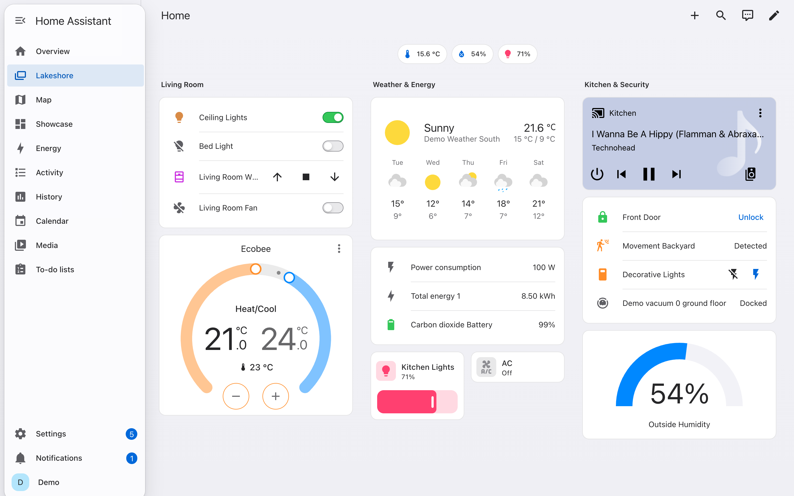
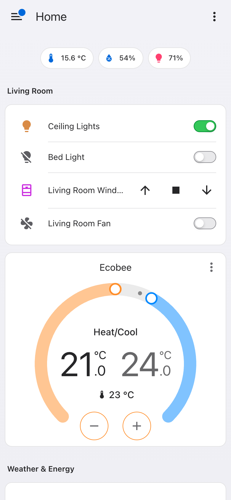
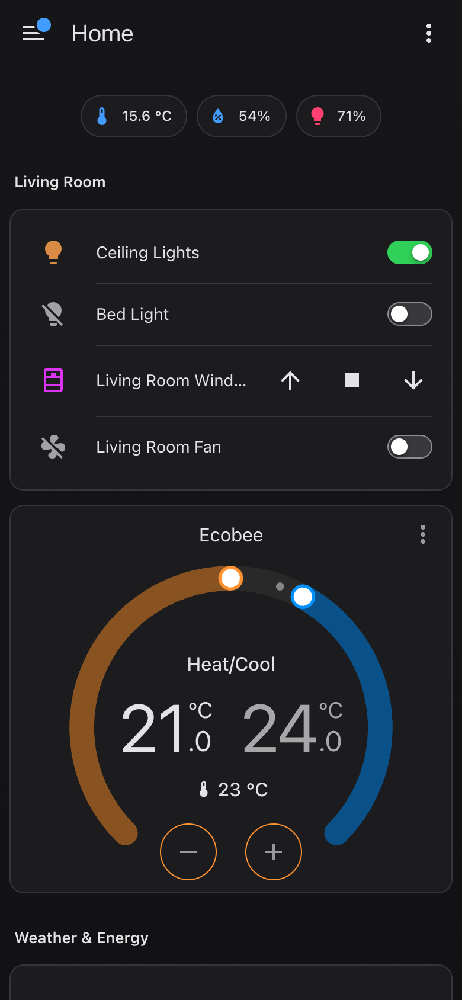
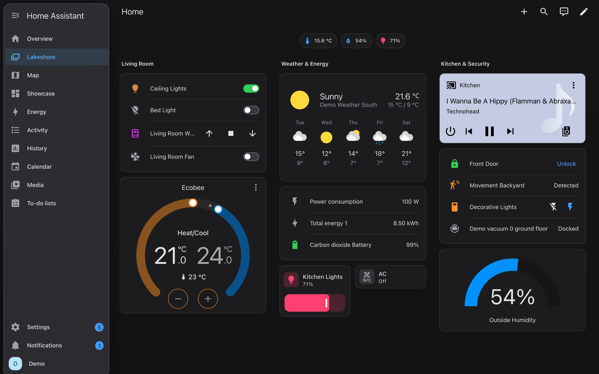
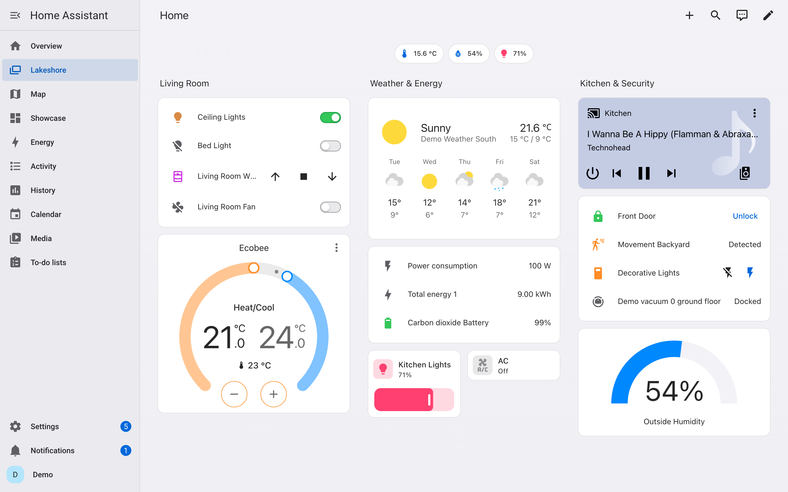
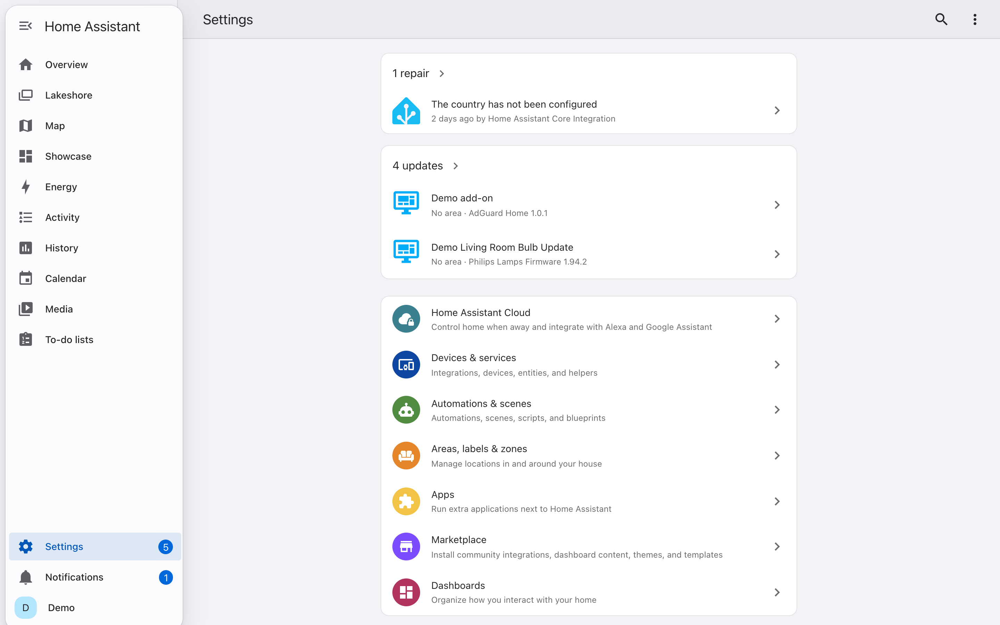
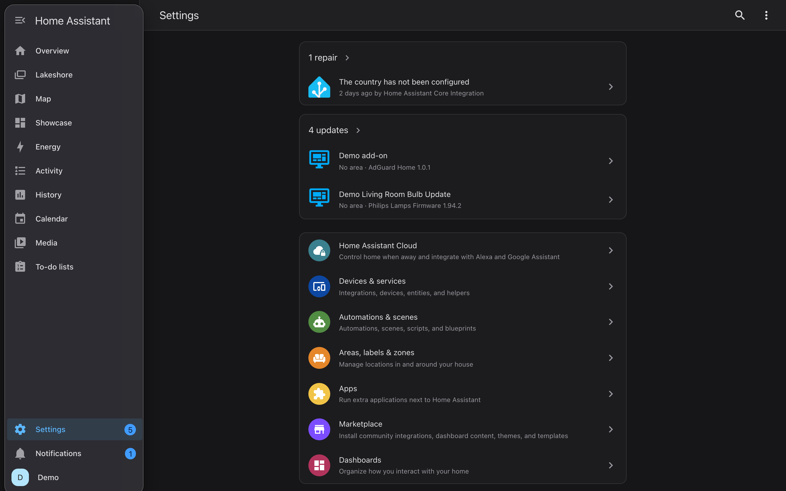

# Lakeshore

[](https://my.home-assistant.io/redirect/marketplace_repository/?owner=wsclx&repository=lakeshore-theme&category=theme)

A theme for Home Assistant inspired by the macOS look: your dashboard reads like the window of a native desktop app. White grouped lists with hairline separators on a calm grey window, a sidebar that floats above the window as a pane of glass, green switches and blue selection. Light and dark mode in one theme.



| Light | Dark |
|---|---|
|  |  |



## What you get

- **One theme, two modes.** Light: white groups on a light grey window. Dark: dark grey groups on an almost black window, with lighter blue for links and selection. It follows the light or dark setting of your profile or device.
- **Two layers.** Content is flat and opaque: cards are grouped lists with a hairline border, a 12 px radius and no shadow. Only the navigation is glass: the sidebar floats above the window with a light rim (card-mod).
- **System colours.** Blue, green, red, orange and the greys use the published system colour values. Where a default value does not reach the WCAG contrast minimum (4.5:1 for text, 3:1 for controls), the theme uses the platform's own increased-contrast value instead: link blue for text and buttons, darker red and orange for error and warning text, a darker rim around the green switch.
- **Green switches with a white thumb**, a blue keyboard focus ring and blue selection in the sidebar, all without add-ons.
- **System font.** The system UI font of your device (`-apple-system`, `system-ui`, Segoe UI, Roboto). Nothing is downloaded.
- **Optional extras with card-mod:** the floating glass sidebar with rounded selection, hairline separators between the rows of entities cards (inset to where the text starts, as in a grouped list), compact section headings and the system font in the sidebar.

Without card-mod the theme still works: groups, colours, switches, selection and focus stay the same; the sidebar is a flat light grey column, rows of entities cards have no separators, and the sidebar keeps the default font.



| Settings, light | Settings, dark |
|---|---|
|  |  |

## Requirements

- Home Assistant with themes enabled. Tested with Home Assistant 2026.11.2 (November 2026).
- Optional: [card-mod](https://github.com/thomasloven/lovelace-card-mod) 4.x for the glass sidebar and the row separators. Tested with card-mod 4.2.1.

## Installation

### Marketplace (HACS)

1. Open **Settings → Marketplace** (or HACS on older versions).
2. Search for **Lakeshore** and download it.
3. Reload themes: **Developer tools → Actions → `frontend.reload_themes`**.

### Manual

1. Copy `themes/lakeshore.yaml` into the `themes` folder of your configuration.
2. Make sure your `configuration.yaml` loads that folder:

   ```yaml
   frontend:
     themes: !include_dir_merge_named themes
   ```

3. Restart Home Assistant or run `frontend.reload_themes`.

## Use the theme

Open your **profile**, choose **Lakeshore** under *Theme*, and pick *Auto*, *Light* or *Dark*.

## Optional: card-mod

The theme contains `card-mod-card` and `card-mod-sidebar` rules. They only apply when card-mod is installed. For theme rules, card-mod recommends loading it as a frontend module instead of a dashboard resource:

```yaml
frontend:
  themes: !include_dir_merge_named themes
  extra_module_url:
    - /local/community/lovelace-card-mod/card-mod.js
```

Adjust the path to where card-mod is installed on your system.

The look of grouped lists works best with **entities cards**: put related devices into one card and they read as one group with separators, like a settings window.

## Customise

Change the variables below in a copy of the theme, or override them with card-mod.

| Variable | Used for |
|---|---|
| `lake-window`, `lake-window-low` | Window background (top and bottom of the gentle gradient behind dashboards) |
| `lake-group` | Background of cards, dialogs and settings panels |
| `lake-field` | Background of input fields |
| `lake-hairline` | Card borders, dividers and row separators |
| `lake-glass`, `lake-glass-rim`, `lake-glass-filter` | Glass sidebar: tint, rim and blur (card-mod) |
| `lake-switch-on`, `lake-switch-on-rim`, `lake-switch-off` | Switch track colours |
| `primary-color`, `sidebar-selected-icon-color` | Blue for links, buttons and the selected sidebar entry |
| `entities-card-row-gap` | Space between rows of entities cards (the separator sits in the middle) |

## Known limits

- Home Assistant does not guarantee theme variables between releases. If something looks off after an update, please open an issue with your version.
- The window frame of a desktop app (title bar, window buttons, the desktop around the window) is not part of a web page and cannot be drawn by a theme.
- Icons stay Material Design Icons; a theme cannot swap icon sets.
- A thin divider line remains at the right edge of the sidebar area (it belongs to the app drawer, which neither a theme variable nor card-mod reaches without also changing every other divider).
- Without card-mod the sidebar keeps the default font of the frontend, and entities cards have no row separators.
- Light and media colours that a card takes from the device (a light's RGB colour, album art) stay as they are.
- The thermostat ring, the weather icons and the size of switches are drawn by the frontend; the theme only sets their colours.
- The system font depends on your device: the system font on Apple devices, Segoe UI on Windows, Roboto on Android, otherwise the default sans-serif.
- The card-mod rules target internal elements of the frontend. A frontend update can break them; the theme itself keeps working.

## Contributing

Issues and pull requests are welcome. Please include your Home Assistant version, card-mod version (if used), browser and a screenshot.

## License

[MIT](LICENSE)

This is a community project. It is not affiliated with or endorsed by Home Assistant or the Open Home Foundation. It is inspired by the macOS look and not affiliated with Apple Inc.; macOS is a trademark of Apple Inc. No Apple artwork, icons, wallpapers or fonts are included.
